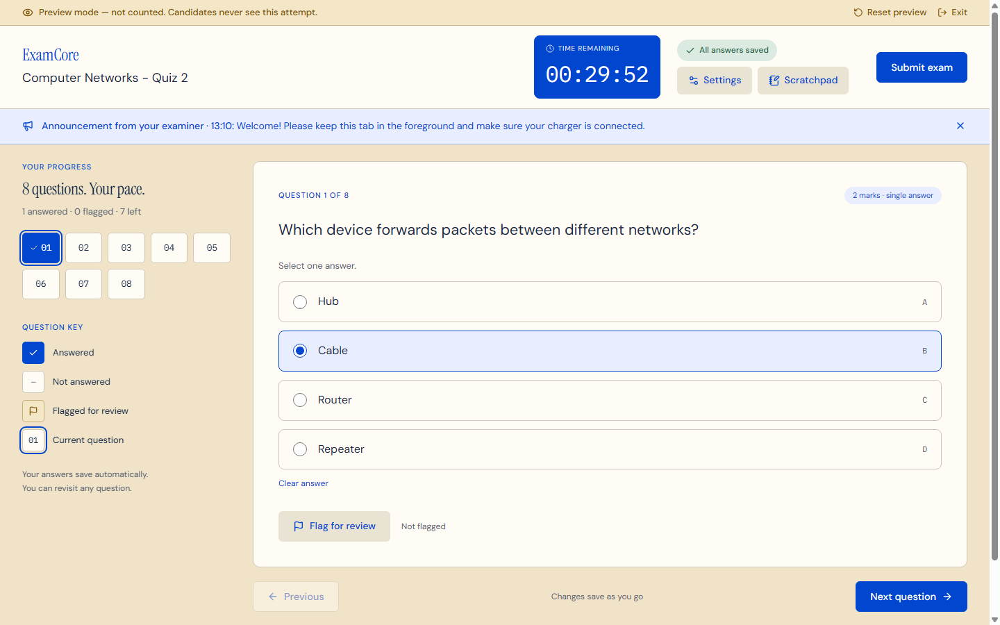
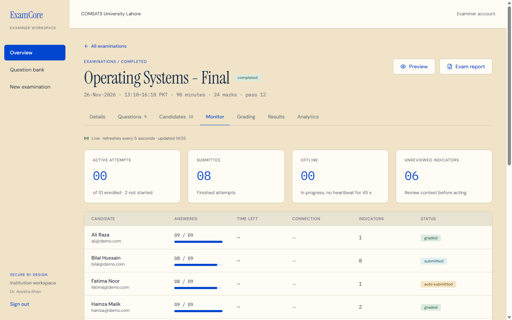
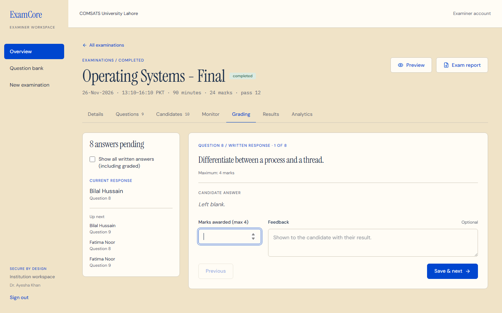
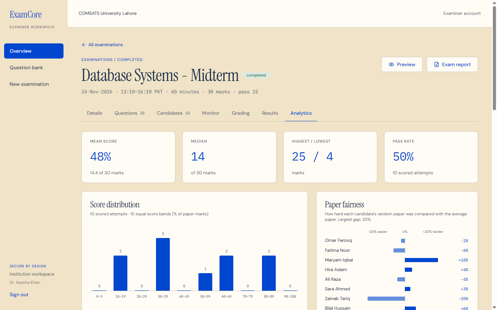
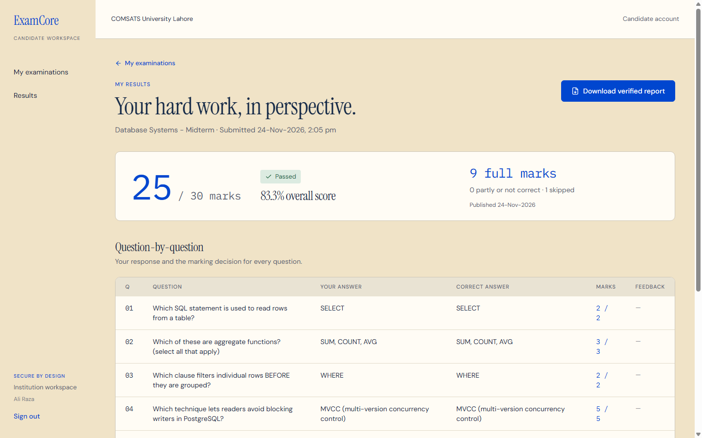
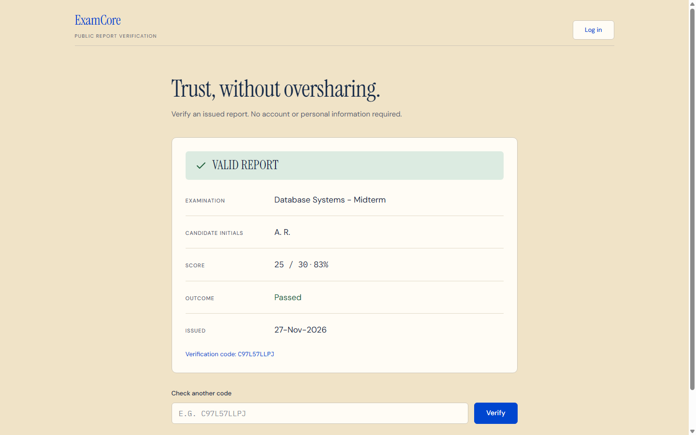

# ExamCore — Secure Examination Management System

Technoverse 5.0 Web-e-Thon (COMSATS Lahore, 27–28 Nov 2026). A full-stack web app where institutions **create, conduct, monitor and evaluate** online exams, with three roles: **admin**, **examiner** and **candidate**.

**Live URL:** _not deployed yet_

## Features
- **Exams:** draft → published → ongoing → completed lifecycle, schedule window, duration, total/pass marks, shuffle settings.
- **Question bank:** topics, difficulty levels, single-answer MCQ, multi-select (all-or-nothing or partial marking), written answers, negative marking.
- **Exam workspace:** server-controlled timer, autosave, resume after refresh, answered / unanswered / flagged navigator, auto-submit at time-up.
- **Monitoring:** live attempts, connection status, incident indicators (never treated as proof), announcements.
- **Grading & results:** auto-grading of objective questions, manual grading of written answers, controlled result publishing, analytics.
- **Secondary features:** network-aware UI, PDF reports (candidate result + exam statistics), examiner sandbox preview, CSV import, question analytics, verifiable reports (QR + 10-character code, public check shows initials only), customizable workspace, digital scratchpad.

## Innovation challenges
- **5.3 Failure-resilient exams:** answers are kept in an offline outbox on the device and synced on reconnect; the server detects outages from missed heartbeats and creates a compensation request that the examiner approves or rejects (capped at 10 minutes), so nobody gets free extra time.
- **5.2 Fairness of randomized exams:** a difficulty blueprint (e.g. 4 easy / 4 medium / 2 hard, equal marks per difficulty) gives every candidate a different but equally weighted paper; analytics compute each paper's observed difficulty and its deviation from the average.

Details and trade-offs: [`docs/DESIGN.md`](docs/DESIGN.md).

## Screenshots
| | |
|---|---|
|  Exam workspace (examiner preview) |  Live monitor: indicators, compensation, announcements |
|  Grading written answers |  Analytics and paper fairness |
|  Candidate result |  Public report verification |

Phone view of a result: [`docs/screenshots/candidate-result-mobile.png`](docs/screenshots/candidate-result-mobile.png). Login: [`docs/screenshots/login.png`](docs/screenshots/login.png).

## Test credentials
_All passwords: `Demo@1234` (created by `npm run seed`)._

| Role | Email |
|---|---|
| Admin | admin@demo.com |
| Examiner | examiner@demo.com |
| Candidate | ali@demo.com · sara@demo.com · hamza@demo.com |
| More candidates | zainab@ · bilal@ · fatima@ · usman@ · hira@ · omar@ · maryam@ `demo.com` |

## Demo data (from `npm run seed`)
| Exam | State | What it shows |
|---|---|---|
| Database Systems - Midterm | finished, **results published** | 10 candidates, random papers from a 4 easy / 4 medium / 2 hard blueprint (fairness analytics), incidents, an approved outage compensation, PDF reports + QR verification |
| Operating Systems - Final | finished, **not published** | written answers waiting in the grading queue, a pending compensation request, an auto-submitted attempt |
| Computer Networks - Quiz 2 | **open now** (stays open 3 days) | start it as a candidate: autosave, offline sync, timer, flags, scratchpad |
| Software Engineering - Practice Test | upcoming | enrolled candidates see it as "opens soon" |
| Web Technologies - Quiz (draft) | draft | build it live as the examiner (questions, blueprint, enrol, publish) |

Running `npm run seed` again is safe: it never deletes anything, skips what exists and only refreshes the dates of the open and upcoming exams.

## Tech stack
Next.js 16 (App Router) · TypeScript · Tailwind CSS v4 · Supabase (Postgres + Auth) · zod · pdf-lib · qrcode · papaparse · lucide-react · Vercel.

## Setup
Requirements: Node.js 24, a free Supabase project.

1. `npm install`
2. In Supabase: Auth → Providers → Email → turn off "Confirm email". SQL Editor → run `backend/db/schema.sql`.
3. Create `.env.local`:
   ```
   SUPABASE_URL=https://xxxx.supabase.co
   SUPABASE_PUBLISHABLE_KEY=...
   SUPABASE_SECRET_KEY=...
   ```
4. `npm run seed` (demo accounts, question bank, 5 demo exams with attempts)
5. `npm run dev` → http://localhost:3000

## Project structure
```
app/        1-line connector files (Next.js routes) → frontend/ pages and backend/ handlers
frontend/   pages, layouts, components, client helpers
backend/    handlers → services → data (Supabase), lib/, db/schema.sql, scripts/seed.ts
shared/     types.ts + validation.ts used by both sides
docs/       problem statement, contract, plans, design
```

## Documentation
- [`docs/PROBLEM_STATEMENT.md`](docs/PROBLEM_STATEMENT.md) — the official brief
- [`docs/CONTRACT.md`](docs/CONTRACT.md) — every API endpoint, error code and validation rule
- [`docs/DESIGN.md`](docs/DESIGN.md) — requirements analysis, ambiguities, DB design, architecture, tech choices
- [`docs/BACKEND_PLAN.md`](docs/BACKEND_PLAN.md) / [`docs/FRONTEND_PLAN.md`](docs/FRONTEND_PLAN.md) — build plans
