# ExamCore: Secure Examination Management System

Technoverse 5.0 Web-e-Thon (COMSATS Lahore, 27-28 Nov 2026). A full-stack web app where institutions **create, conduct, monitor and evaluate** online exams, with three roles: **admin**, **examiner** and **candidate**.

**Live site: https://technoverse-webathon.vercel.app**

## Try it now (demo logins)

On the login page you can also use the **one-tap demo access** buttons (Admin, Examiner, Candidate).

**Every account uses the password `Demo@1234`.**

| Role | Email | What to look at |
|---|---|---|
| **Admin** | `admin@demo.com` | Users: search, change roles, deactivate, CSV import. Also sees every exam and the question bank. |
| **Examiner** | `examiner@demo.com` | Overview of exams, question bank, create and publish an exam, live monitor, grading, results, analytics, PDF reports. |
| **Candidate** | `ali@demo.com` | Dashboard, take the open exam, see published results and download the verified PDF. |
| More candidates | `sara@demo.com`, `hamza@demo.com`, `zainab@demo.com`, `bilal@demo.com`, `fatima@demo.com`, `usman@demo.com`, `hira@demo.com`, `omar@demo.com`, `maryam@demo.com` | Same password. |

**Public report check (no login):** open `/verify/C97L57LLPJ` on the live site.

### What is in the demo data
| Exam | State | What it shows |
|---|---|---|
| Database Systems - Midterm | finished, **results published** | 10 candidates with random papers from a 4 easy / 4 medium / 2 hard blueprint (fairness analytics), incidents, an approved outage compensation, PDF reports and QR verification |
| Operating Systems - Final | finished, **not published** | written answers waiting in the grading queue, a pending compensation request, an auto-submitted attempt |
| Computer Networks - Quiz 2 | **open now** (open until 30 Nov) | start it as a candidate: autosave, offline sync, server timer, flags, scratchpad |
| Software Engineering - Practice Test | upcoming | enrolled candidates see it as "opens soon" |
| Web Technologies - Quiz (draft) | draft | build it live as the examiner: questions, blueprint, enrol candidates, publish |

Tip for the demo: a candidate can attempt an exam only once. To try the exam screen without using up a candidate, log in as the examiner and press **Preview** on Quiz 2 (a sandbox attempt that is never counted).

## Features
- **Exams:** draft, published, ongoing, completed lifecycle (derived from the dates, so it can never be wrong), schedule window, duration, total and pass marks, shuffle settings.
- **Question bank:** topics, difficulty levels, single-answer MCQ, multi-select (all-or-nothing or partial marking), written answers, negative marking.
- **Exam workspace:** server-controlled timer, autosave, resume after refresh, answered / unanswered / flagged navigator, auto-submit at time-up, digital scratchpad (text and drawing), keyboard shortcuts.
- **Monitoring:** live attempts and connection status, incident indicators (never treated as proof), announcements to all candidates.
- **Grading and results:** auto-grading of objective questions, manual grading of written answers, controlled result publishing, analytics (score distribution, question statistics, paper fairness).
- **PDF reports:** a branded candidate result report (score card, per-question table, QR and verification code) and an exam report with statistics and a score table.
- **Verifiable reports:** QR plus a 10-character code; the public check page shows only initials, score and date.
- **CSV import** of candidates and questions with row-level error messages.
- **Seven themes** (Light, Dark, Sepia, Ocean, Forest, Midnight, High contrast) with a swatch menu in every dashboard, three text sizes, saved to the account so they come back at the next login.
- **Mobile friendly:** checked at 375 px and 320 px with no sideways scrolling.

## Innovation challenges
- **5.3 Failure-resilient exams:** answers are kept in an offline outbox on the device and synced when the connection returns; the server detects outages from missed heartbeats and creates a compensation request that the examiner approves or rejects (capped at 10 minutes), so nobody gets free extra time.
- **5.2 Fairness of randomized exams:** a difficulty blueprint (for example 4 easy / 4 medium / 2 hard, equal marks per difficulty) gives every candidate a different but equally weighted paper; analytics compute each paper's observed difficulty and its gap from the average.

Details and trade-offs: [`docs/DESIGN.md`](docs/DESIGN.md).

## Security and validation
- Every input is validated twice: in the browser (form errors) and on the server (`400` with per-field messages, one zod schema shared by both sides).
- The database is reached only from the server with a secret key; row level security is on. Role and ownership checks run in the service layer on every request.
- The exam clock lives on the server; late saves are refused. One real attempt per candidate is enforced by a database index, not only by code.

## Performance
Measured first, then fixed (details in [`docs/DESIGN.md`](docs/DESIGN.md)). The API was taking 1 to 2 seconds per call because the Vercel functions ran in Virginia while the database is in Mumbai. After moving the functions to Mumbai, checking login tokens on our server, running independent queries together, and adding "Show more" paging and indexes, calls take about 0.4 s from a far-away laptop (down from 1.0 to 2.0 s).

## Screenshots
| | |
|---|---|
| 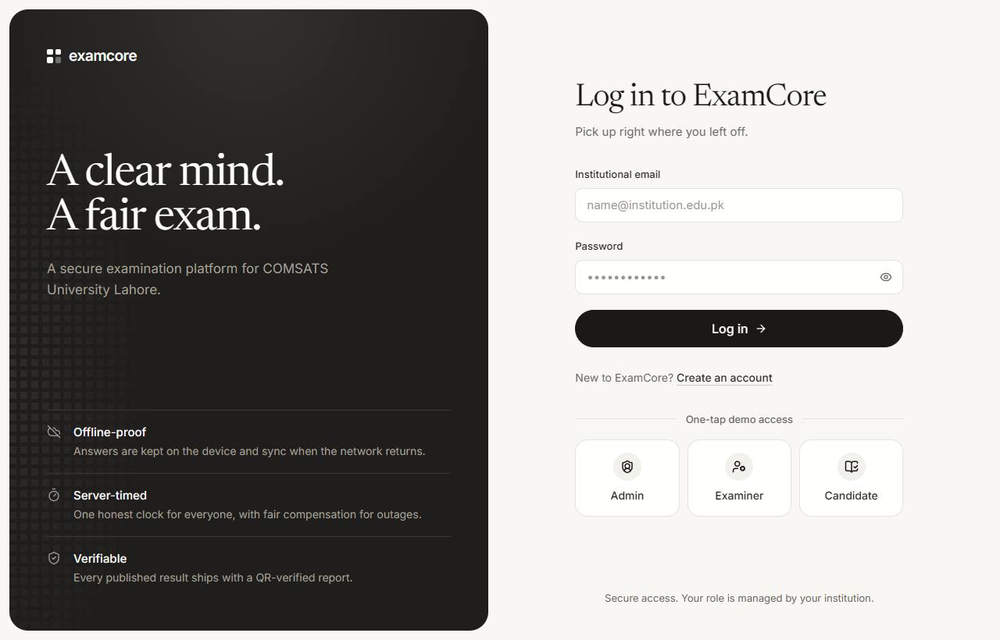 Login with one-tap demo access | 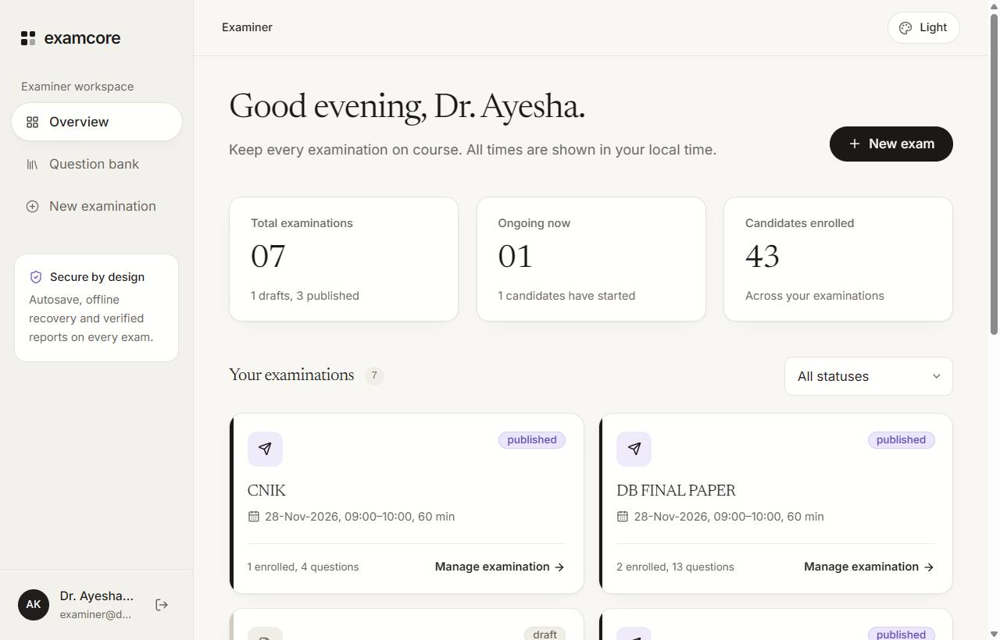 Examiner overview |
| 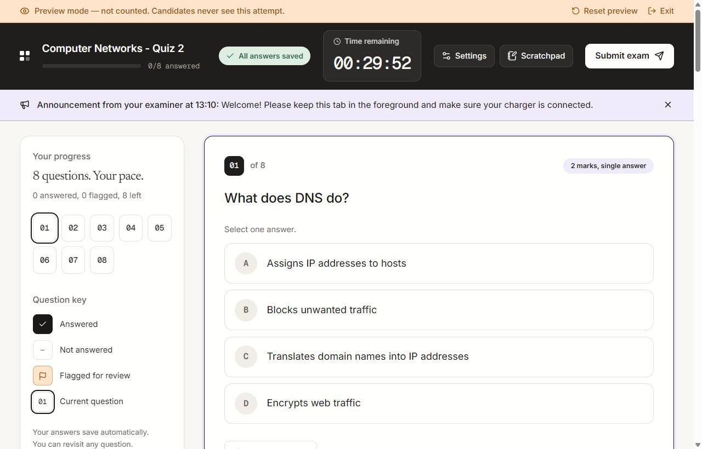 Exam workspace (examiner preview) | 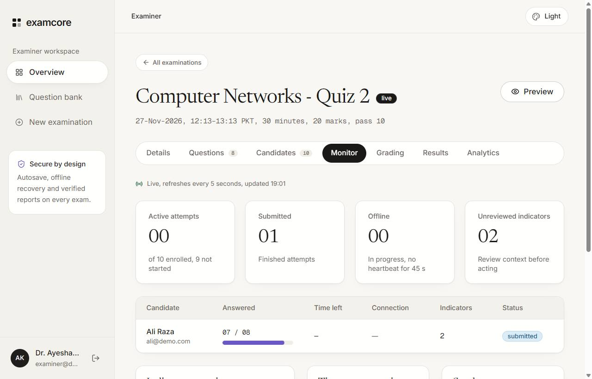 Live monitor, compensation, announcements |
| 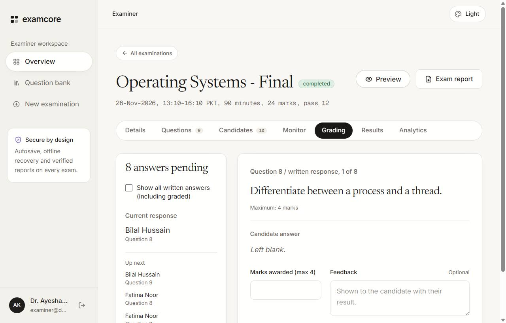 Grading written answers | 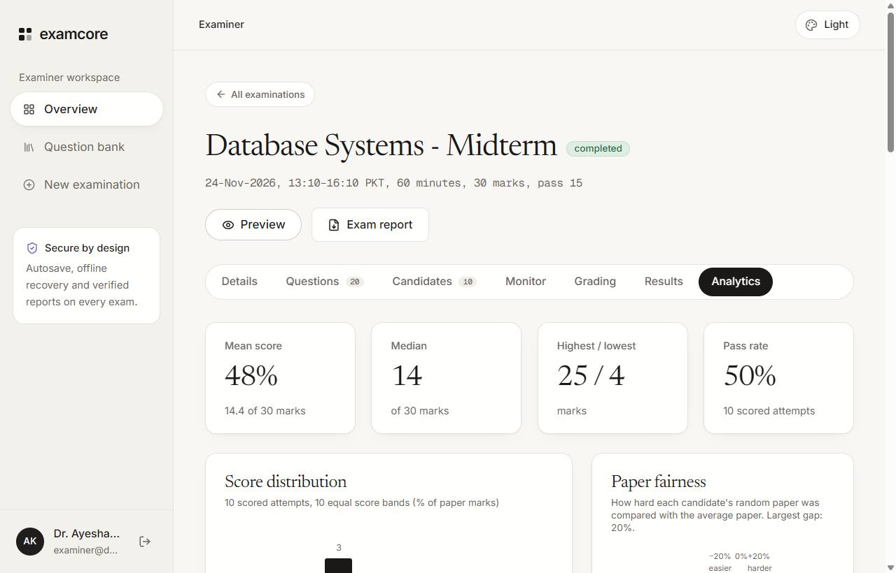 Analytics and paper fairness |
| 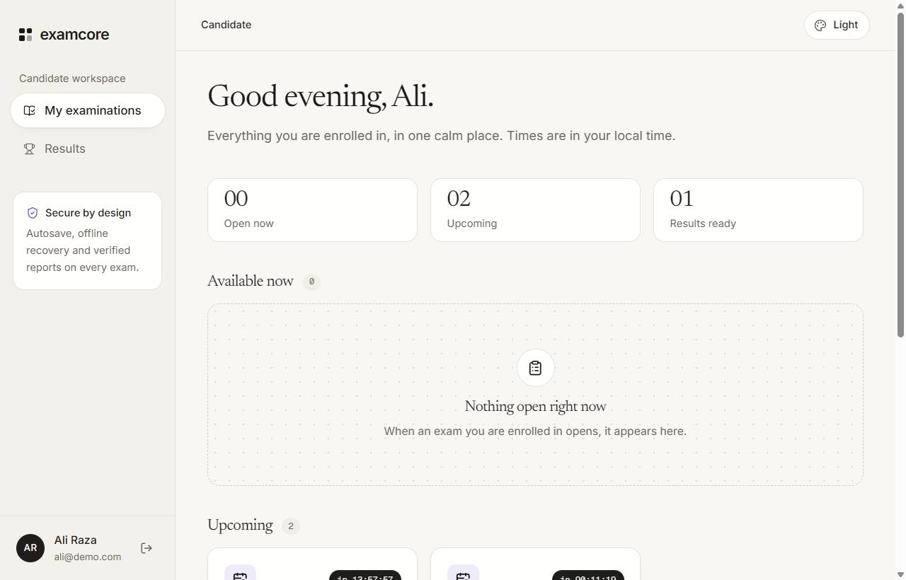 Candidate dashboard | 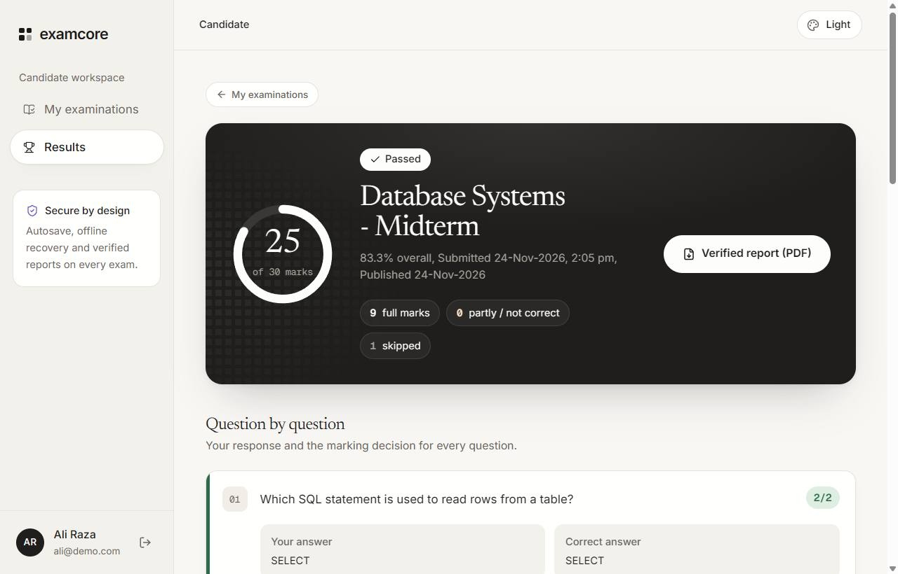 Candidate result |
| 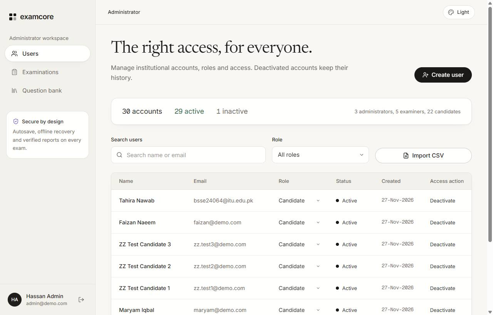 Admin: users and roles | 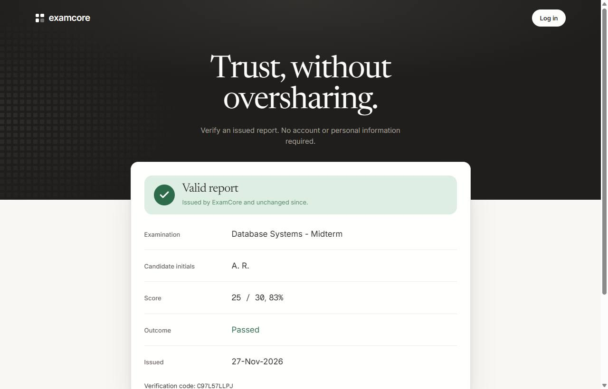 Public report verification |
| 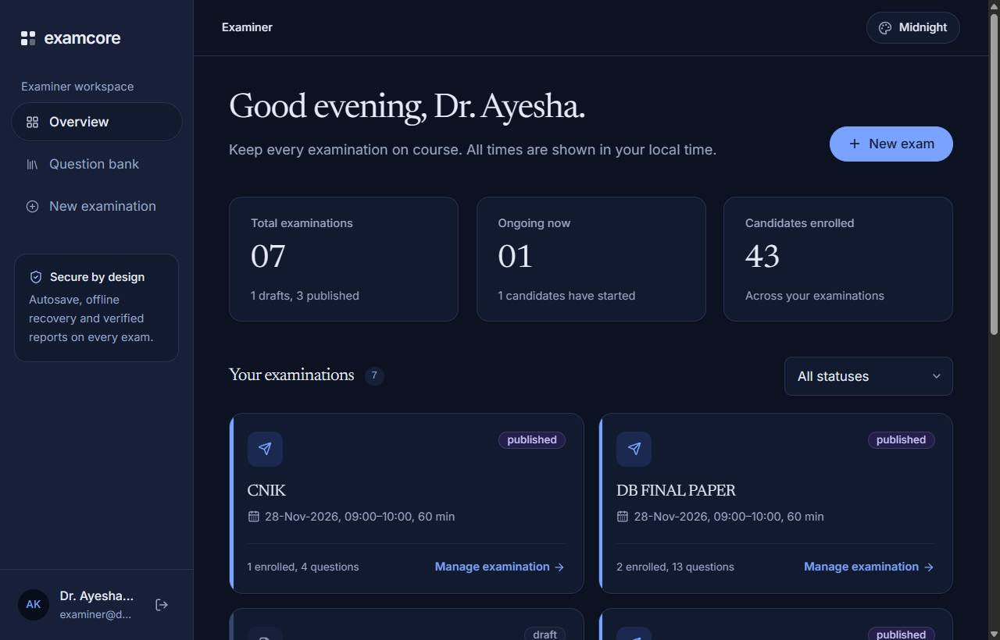 Midnight theme | 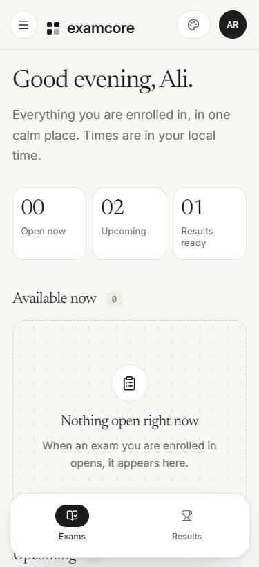 Phone view (375 px) |

## Tech stack
Next.js 16 (App Router) · TypeScript · Tailwind CSS v4 · Supabase (Postgres + Auth) · zod · pdf-lib · qrcode · papaparse · lucide-react · Vercel.

## Run it yourself
Requirements: Node.js 24 and a free Supabase project.

1. `npm install`
2. In Supabase: Auth, Providers, Email, turn off "Confirm email". SQL Editor: run `backend/db/schema.sql`.
3. Create `.env.local`:
   ```
   SUPABASE_URL=https://xxxx.supabase.co
   SUPABASE_PUBLISHABLE_KEY=...
   SUPABASE_SECRET_KEY=...
   ```
4. `npm run seed` creates the demo accounts, the question bank and the 5 demo exams with attempts. It is safe to run again: it never deletes anything and only refreshes the dates of the open and upcoming exams.
5. `npm run dev`, then open http://localhost:3000

## Project structure
```
app/        1-line connector files (Next.js routes) -> frontend/ pages and backend/ handlers
frontend/   pages, layouts, components, client helpers
backend/    handlers -> services -> data (Supabase), lib/, db/schema.sql, scripts/seed.ts
shared/     types.ts + validation.ts used by both sides
docs/       problem statement, contract, plans, design
```

## Documentation
- [`docs/PROBLEM_STATEMENT.md`](docs/PROBLEM_STATEMENT.md): the official brief
- [`docs/CONTRACT.md`](docs/CONTRACT.md): every API endpoint, error code and validation rule
- [`docs/DESIGN.md`](docs/DESIGN.md): requirements analysis, ambiguities, database design, architecture, technology choices, performance
- [`docs/BACKEND_PLAN.md`](docs/BACKEND_PLAN.md) and [`docs/FRONTEND_PLAN.md`](docs/FRONTEND_PLAN.md): build plans
